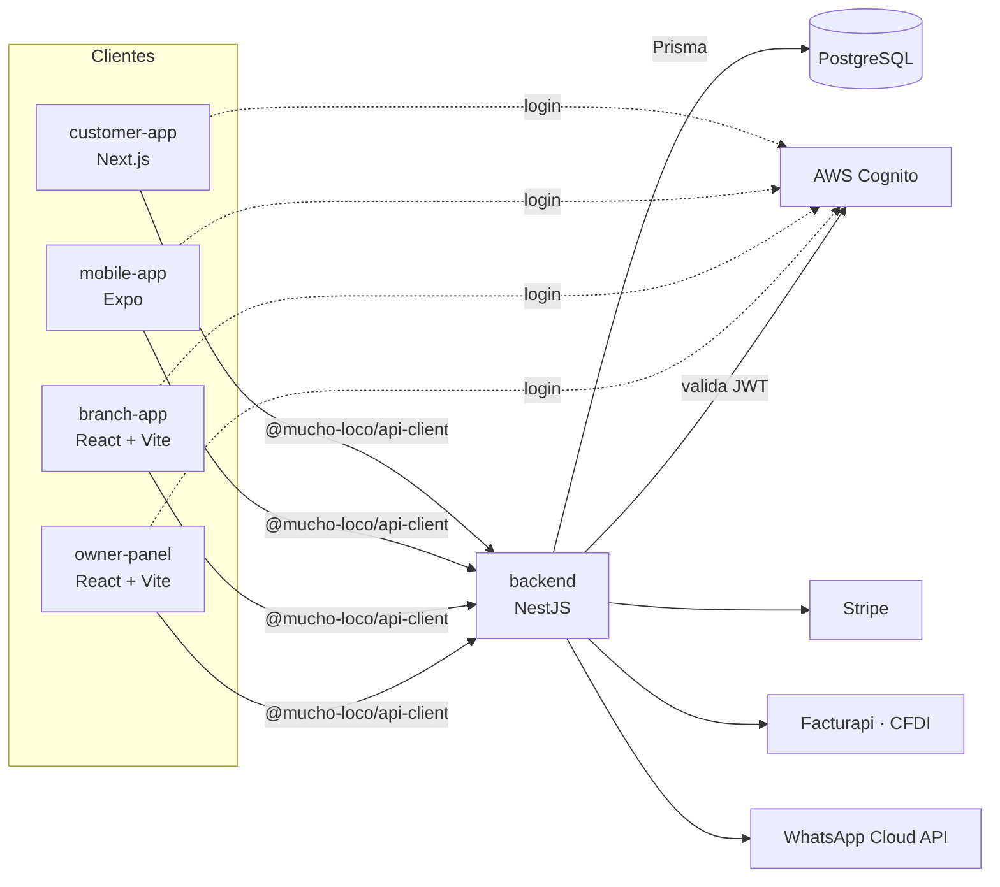

# Mucho Loco Gym

Plataforma completa para una cadena de gimnasios de 15 sucursales en la CDMX: tienda en línea, membresías con
cobro recurrente, app móvil del socio, app de sucursal para el personal y panel del dueño, todo sobre una sola API.

La diseñé y la construí yo solo, de punta a punta: frontend, móvil, backend, base de datos, infraestructura y CI/CD.

**Stack:** TypeScript · Next.js 15 · React 19 · React Native (Expo) · NestJS · Prisma · PostgreSQL · AWS Cognito ·
Stripe · Terraform · GitHub Actions

---

## Qué hace

| App | Para quién | Qué resuelve |
|---|---|---|
| [`customer-app`](apps/customer-app) — Next.js | Socios y clientes | Landing con mapa de sucursales y precios, tienda (catálogo, carrito, checkout), contratación de membresía, panel del socio con QR de acceso, pedidos, facturación, rendimiento y comunidad |
| [`mobile-app`](apps/mobile-app) — React Native + Expo | Socios | La misma experiencia del socio en iOS y Android, reutilizando la lógica de la web |
| [`branch-app`](apps/branch-app) — React + Vite | Personal de sucursal | Validar el QR de acceso, venta de mostrador, caja y corte, entrega de pedidos, asistencia del personal, inventario y reportes locales |
| [`owner-panel`](apps/owner-panel) — React + Vite | Dueño / oficinas centrales | Dashboard ejecutivo, inventario global y transferencias, envíos a domicilio, gastos, nómina, auditoría de cortes de caja y CFDI emitidos |
| [`backend`](apps/backend) — NestJS | Las cuatro apps | API REST con documentación OpenAPI en `/docs`, autenticación, pagos, facturación y notificaciones |

### Funcionalidades destacadas

- **Usuarios y permisos:** registro e inicio de sesión con correo, Google o Facebook (AWS Cognito, OAuth 2.0 + PKCE);
  roles distintos para socio, mostrador, gerente y dueño, validados en la API con JWT.
- **Pagos con Stripe:** checkout de la tienda (tarjeta, OXXO, SPEI), membresías como suscripción con renovación
  automática, periodo de gracia y portal del cliente. Los pedidos solo se marcan pagados por webhook verificado.
- **Facturación electrónica CFDI 4.0:** el socio factura desde la web o el móvil, el ticket de mostrador trae clave
  de autofacturación y el dueño consulta y cancela CFDI. Integrado con Facturapi, con cola y reintentos.
- **Avisos por WhatsApp:** vencimiento de membresía, pedido en camino y confirmaciones, vía WhatsApp Cloud API con
  plantillas, idempotencia y preferencias por socio.
- **Control de acceso:** un QR por socio que valida la sucursal según el plan; cada acceso registra la visita, y de
  ahí salen la racha, el heatmap de asistencia y el tráfico por sucursal.
- **Operación del negocio:** inventario por sucursal y bodega central, caja con corte auditable, nómina calculada a
  partir de la asistencia real (calendario de la CDMX), gastos y reportes ejecutivos.
- **Bilingüe:** español e inglés en todas las apps.

---

## Arquitectura



- **Monorepo** con pnpm workspaces y Turborepo. Los tipos de dominio (`packages/types`), el cliente HTTP
  (`packages/api-client`) y la lógica del socio (`packages/customer-core`) se comparten entre las apps, así que la web
  y el móvil usan exactamente el mismo contrato, mocks, precios y textos.
- **Contract-first:** cada frontend se construyó primero contra repositorios mock y después se cambió a la API real
  con una sola variable (`*_DATA_SOURCE=mock|http`). Por eso cualquier app se puede correr sin backend.
- **Backend** como monolito modular en NestJS: un módulo por dominio (sucursales, productos, membresías, pagos,
  facturación, notificaciones, caja, nómina…), listo para separarse si algún día hace falta.
- **Infraestructura como código** en [`infra/`](infra) con Terraform: VPC, RDS PostgreSQL, ECR, ECS Fargate detrás de
  un ALB y Cognito. El frontend web está pensado para desplegarse en Vercel.

## Cómo se construyó

- **Desarrollo guiado por especificaciones:** cada funcionalidad tiene su spec en [`specs/`](specs/README.md)
  (56 en total) con requisitos, plan y tareas ligadas al test que las verifica. Se trabajó con
  [Spec Kit](https://github.com/github/spec-kit) y Claude Code como agente de desarrollo.
- **Pruebas:** más de 140 archivos de pruebas: unitarias (Jest y Vitest), de integración que comparan mock contra la
  API real campo por campo, e2e de las apps con Playwright y e2e del backend contra PostgreSQL real.
- **CI/CD con GitHub Actions:** [`test.yml`](.github/workflows/test.yml) corre typecheck, lint, unitarias, e2e y
  pruebas de contrato en cada push; [`deploy.yml`](.github/workflows/deploy.yml) construye la imagen Docker, la sube a
  ECR y redespliega ECS usando OIDC, sin llaves de AWS guardadas.
- **Decisiones documentadas:** el porqué de cada elección (Vite en lugar de Next.js para las apps internas, Expo en
  lugar de Flutter, Terraform en lugar de CDK, Prisma 6 en lugar de 7…) está en los `CLAUDE.md` de la raíz y de cada app.

## Estado

| Pieza | Estado |
|---|---|
| Las cinco apps y sus flujos | Funcionando de punta a punta en local, con mocks o contra la API |
| Pagos con Stripe | Probados contra el sandbox real de Stripe (pago, webhook, suscripción, gracia y cancelación) |
| Login con Cognito | Probado contra un User Pool real |
| CFDI y WhatsApp | Integración implementada y cubierta con pruebas; falta conectar las cuentas reales de Facturapi y Meta |
| Infraestructura AWS | Terraform completo (`terraform plan` limpio); se levanta y se destruye bajo demanda para no generar costo |

---

## Correrlo en local

Requisitos: Node.js 22, [pnpm](https://pnpm.io) y, solo para el backend, PostgreSQL 16.

```bash
pnpm install

# Cualquier frontend funciona solo, con datos de prueba (modo mock por defecto)
pnpm --filter @mucho-loco/customer-app dev
pnpm --filter @mucho-loco/branch-app dev
pnpm --filter @mucho-loco/owner-panel dev
pnpm --filter @mucho-loco/mobile-app start
```

Para usar la API real:

```bash
createdb mucho_loco_dev
cp apps/backend/.env.example apps/backend/.env      # completar DATABASE_URL
pnpm --filter @mucho-loco/backend exec prisma migrate dev
pnpm --filter @mucho-loco/backend exec prisma db seed
pnpm --filter @mucho-loco/backend start:dev          # documentación en http://localhost:3001/docs
```

Después, en el `.env` de cada frontend (plantilla en su `.env.example`), cambiar `*_DATA_SOURCE` a `http`.

```bash
pnpm test        # pruebas de todo el monorepo vía Turborepo
pnpm build
```

## Estructura

```
apps/
  customer-app/    Next.js: tienda y portal del socio
  mobile-app/      Expo: app del socio para iOS y Android
  branch-app/      React + Vite: operación de sucursal
  owner-panel/     React + Vite: panel del dueño
  backend/         NestJS + Prisma: API
packages/
  types/           tipos de dominio compartidos
  api-client/      cliente HTTP de la API
  customer-core/   contrato, mocks y lógica del socio (web y móvil)
infra/             Terraform (AWS)
specs/             especificaciones por funcionalidad
```

---

Hecho por **Miguel Ángel Mora Rodríguez** · [GitHub](https://github.com/MiguelMora-bit) ·
[miguelmora6095@gmail.com](mailto:miguelmora6095@gmail.com)
